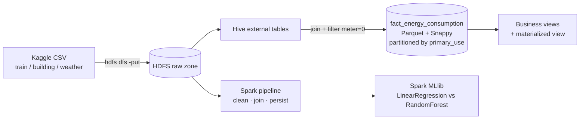
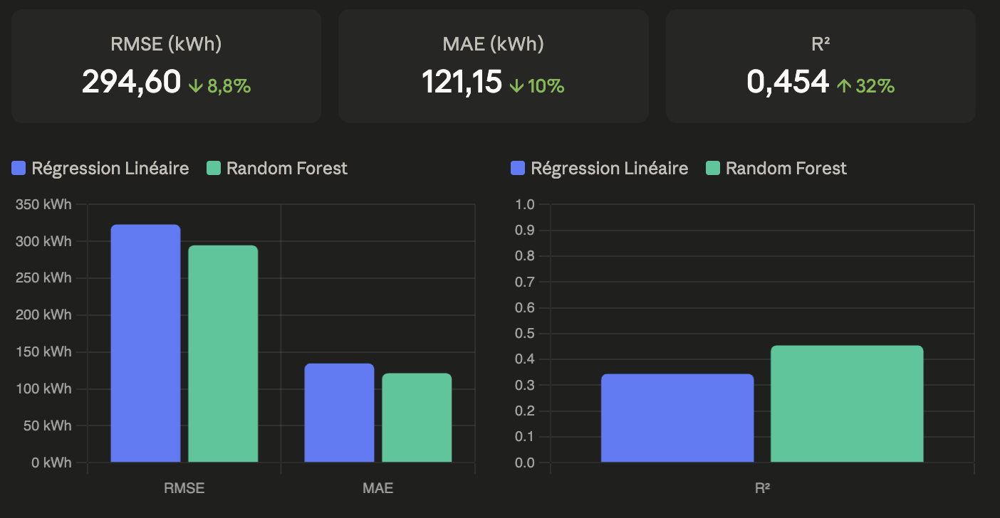
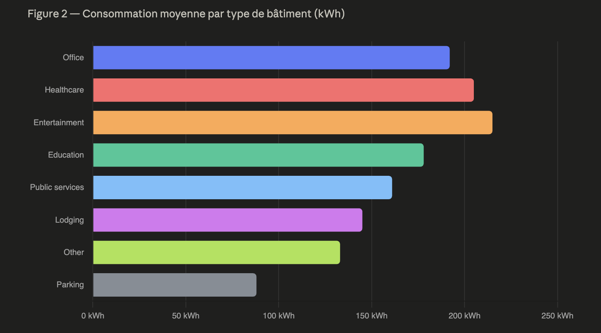
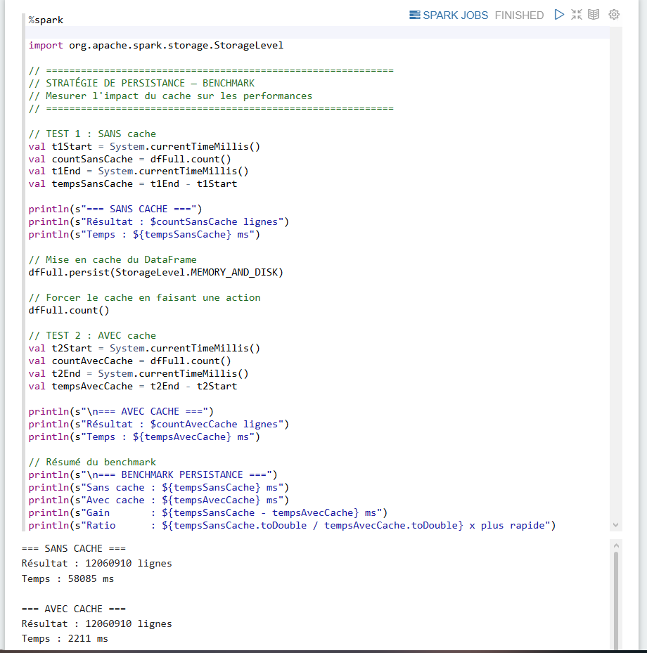

# Building Energy Consumption — Big Data Pipeline (Hive + Spark)

End-to-end Big Data pipeline on **Hortonworks HDP 3.0** to analyse and predict the electricity consumption of ~1,450 buildings from **20M+ hourly meter readings** (ASHRAE Great Energy Predictor III).

**Stack:** HDFS · Apache Hive (Tez) · Apache Spark 2.3 (Scala) · Spark MLlib · Apache Zeppelin · Parquet/Snappy

## Business context

A public authority managing thousands of buildings (schools, offices, hospitals, sports facilities) wants to:

- anticipate consumption peaks to negotiate energy contracts,
- detect abnormal buildings (waste, technical faults),
- forecast consumption to plan budgets.

## Architecture



## What's inside

| Module | File | Highlights |
|---|---|---|
| 1. Hive warehouse | [`hive/01_hive_warehouse.sql`](hive/01_hive_warehouse.sql) | 3 external tables on HDFS · managed **Parquet/Snappy** fact table with **dynamic partitioning** by building type · 3 business views (monthly averages, anomaly detection > 2× category mean, monthly peaks per site) · **materialized view** with `REBUILD` · `EXPLAIN` / CBO analysis |
| 2. Spark pipeline | [`spark/02_spark_pipeline.scala`](spark/02_spark_pipeline.scala) | Load 20M rows from HDFS · cleaning & imputation · inner + left joins (meter × building × weather) → **12.06M rows × 16 cols** · `MEMORY_AND_DISK` persistence benchmark |
| 3. Spark MLlib | [`spark/03_spark_ml.scala`](spark/03_spark_ml.scala) | Temporal features (hour, weekday, season, peak hour, **cyclic sin/cos encoding**) · `StringIndexer` + `OneHotEncoder` + `VectorAssembler` pipeline · Linear Regression (ElasticNet) vs Random Forest |

## Results

**Spark persistence:** a `count()` on the joined dataset went from **58.1 s to 2.2 s** with `MEMORY_AND_DISK` caching (**~26× faster**).

**Prediction (test set, 80/20 split, 5% sample):**

| Model | RMSE (kWh) | MAE (kWh) | R² |
|---|---|---|---|
| Linear Regression (ElasticNet) | 322.98 | 134.53 | 0.344 |
| **Random Forest** (20 trees, depth 5) | **294.60** | **121.15** | **0.454** |

<p align="center">
  
  
</p>

<details>
<summary>Spark cache benchmark (Zeppelin)</summary>

</details>

### Limitations & next steps

- Training on a **5% sample** due to YARN memory limits on a single-node sandbox → train on the full dataset with a tuned cluster.
- No occupancy/calendar features (holidays, school breaks) → biggest expected gain, especially for Education buildings.
- Try `GBTRegressor` + `CrossValidator` / `ParamGridBuilder`.

## How to run

**Prerequisites:** HDP 3.0 sandbox (VirtualBox/VMware/Docker) with HDFS, YARN, Hive and Zeppelin running.

1. Download the data (see [`data/README.md`](data/README.md)) and copy the CSVs to the sandbox:
   ```bash
   scp -P 2222 train.csv building_metadata.csv weather_train.csv root@<SANDBOX_IP>:/root/
   ```
2. Load them into HDFS:
   ```bash
   ./scripts/load_hdfs.sh /root
   ```
3. In Zeppelin (port 9995), run in order:
   - `hive/01_hive_warehouse.sql` with the `%jdbc(hive)` interpreter
   - `spark/02_spark_pipeline.scala` with `%spark`
   - `spark/03_spark_ml.scala` with `%spark`

## Repository structure

```
├── hive/01_hive_warehouse.sql      # Hive DDL, ETL into Parquet, views, EXPLAIN
├── spark/02_spark_pipeline.scala   # Spark cleaning, joins, caching benchmark
├── spark/03_spark_ml.scala         # Feature engineering + MLlib models
├── scripts/load_hdfs.sh            # HDFS ingestion
├── data/README.md                  # Dataset source
└── docs/                           # Full report & slides (French), figures
```

> Code comments and the full report are in French.

## Team

Academic project — *Big Data Technologies*, Université Internationale de Rabat (ESIN), 4th year AI & Big Data, 2025–2026.

- **Yahya ABOU EL AZIZ**
- Mehdi GUELLIDA
- Younes EL MAJDOUBI EL IDRISSI

Supervised by Pr. Houda Benbrahim and Pr. Karim Baïna.
